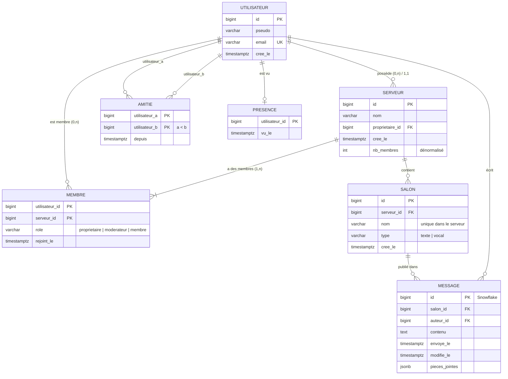

# MCD — plateforme de discussion (version 2)

LAUGIER Gabriel — B3 Dev. Repris du jour 1. Un seul changement : la pièce jointe n'est plus une entité à part mais une propriété du message à forme variable (0 ou 1 par message, RG9), stockée en JSONB dans PostgreSQL et en sous-document dans MongoDB.

## Entités et associations (notation Merise, cardinalités min,max)

| Association | Côté 1 | Côté 2 | Propriétés |
|---|---|---|---|
| EST MEMBRE | UTILISATEUR (0,n) | SERVEUR (1,n) | role, rejoint_le |
| POSSÈDE | UTILISATEUR (0,n) | SERVEUR (1,1) | — |
| CONTIENT | SERVEUR (0,n) | SALON (1,1) | — |
| PUBLIÉ DANS | SALON (0,n) | MESSAGE (1,1) | — |
| ÉCRIT | UTILISATEUR (0,n) | MESSAGE (1,1) | — |
| EST AMI AVEC (réflexive) | UTILISATEUR (0,n) | UTILISATEUR (0,n) | depuis |
| EST VU | UTILISATEUR (0,1) | PRÉSENCE (1,1) | vu_le (expire après 5 min) |

Entités : UTILISATEUR (id, pseudo, email, cree_le) · SERVEUR (id, nom, cree_le, nb_membres calculé) · SALON (id, nom, type, cree_le) · MESSAGE (id Snowflake, contenu, envoye_le, modifie_le, pieces_jointes à forme variable).

## Même modèle en diagramme entité-association (Mermaid)

## MLD (clé primaire en **gras**, # = clé étrangère)

- UTILISATEUR(**id**, pseudo, email, cree_le)
- SERVEUR(**id**, nom, #proprietaire_id, cree_le, nb_membres)
- MEMBRE(**#utilisateur_id, #serveur_id**, role, rejoint_le)
- SALON(**id**, #serveur_id, nom, type, cree_le)
- MESSAGE(**id**, #salon_id, #auteur_id, contenu, envoye_le, modifie_le, pieces_jointes)
- AMITIE(**#utilisateur_a, #utilisateur_b**, depuis)
- PRESENCE(**#utilisateur_id**, vu_le)
- Vue matérialisée ACTIVITE_SERVEUR_JOUR(**serveur_id, jour**, nb_messages, nb_auteurs)
